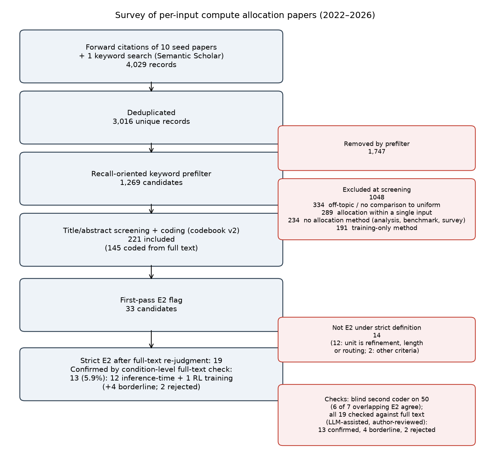

# Appendix D — Papers allocating repeated attempts by "harder gets more" (HGM)

*HGM is labelled E2 in the codebook and the survey files; the two names refer to the same strict definition.*

*Figure 5. Survey flow. Screening-exclusion categories are grouped from coders' free-text reasons by keyword, so they are approximate.*

**Strict definition.** A paper qualifies only if all four hold:
- (a) the allocated unit is repeated independent attempts on the same input;
- (b) a difficulty-level signal gives harder inputs more attempts, monotonically;
- (c) there is no discount, abstention or deprioritization for hopeless inputs (a global cap reachable by every input is not a discount);
- (d) evaluation is against uniform or fixed allocation.

**Process.**
- 33 candidates were flagged by first-pass coding of 221 included papers. All were re-judged with full text (32 of 33 opened).
- A blind second coder recoded a stratified random sample of 50 included papers (15 first-pass E2 candidates, 35 others; `make_validation.py`). Agreement on the E2 flag was 41 of 50 (Cohen's κ = 0.51; `agreement.py`). The second coder flagged 8 as E2. Of the 7 that were also first-pass candidates, the strict re-judgment agrees on 6.
- **Full-text check of all 19.** All 19 papers kept by the re-judgment were checked against their full text, condition by condition. The check was LLM-assisted: an LLM read each paper and proposed a verdict with section-level evidence, the authors reviewed every verdict, and the authors judged the ambiguous cases themselves against the full text. Records: `survey/big/human_check_E2_results.md` (a random sample of 10 included papers, covering 7 of the 19) and `human_check_E2_remaining12_results.md` (the other 12).
  - In the random sample of 10, all 7 strict-E2 papers were confirmed. Of the 3 disagreements, two concern whether refinement rounds count as repeated attempts, and the third (aborting runs predicted to fail) was marked unclear.
  - Across all 19, the check confirmed 13, left 4 borderline and rejected 2.
- Fragments below are verbatim from the source (≤15 words) unless marked *paraphrase*.

**Counting.**
- **Confirmed (13, 5.9% of 221).** All four conditions hold.
  - 12 allocate at inference time, each with an independent rule.
  - 1 allocates RL training rollouts (marked †).
- **Borderline (4).** One condition is unclear.
  - Including them gives 17 (7.7%).
  - The 4 are CoBa, AttnRL†, ODAR and Distributional PRM‡. ‡ marks a reuse of the IAS rule, so it is not an independent rule.
- **Rejected by the full-text check (2).** Dynasor and Gated GeoBoN.

| # | check | paper (arXiv) | allocation rule | verbatim fragment | section |
|---|---|---|---|---|---|
| 1 | confirmed | Make Every Penny Count (DSC), 2408.13457 | Easy: 1 sample. Hard: resample until a stopping criterion, else cap 40. | "For problems belonging to easy part, a single CoT sampling is performed" | §2, §2.3 |
| 2 | confirmed | Evolving in-context demonstrations, 2604.21018 | Unsolved queries keep sampling each round until T. Elimination uses a ground-truth oracle. | "focuses compute on harder queries as easier ones are resolved" | §4.2.2, Alg. 1 |
| 3 | confirmed | Think Right, Not More, 2509.22101 | Level-0 claims: one shot. Level-1 claims (including persistently misclassified ones): expanded best-of-N. | "one-shot inference for level-0 claims, and expanded reasoning for level-1" | §3.2 |
| 4 | borderline (a) | CoBa, 2608.07424 | One extra candidate at a time until the top answer is stable and highly scored, up to max. The extra compute also routes the top-K candidates to a strong verifier. | "Generate one additional candidate and score it" | Alg. 1 (§4) |
| 5 | confirmed | Scaling with Confidence (CAS), 2607.01612 | Sample until stop-probability exceeds a threshold or reaches N. The threshold is tuned on evaluation sets. | "otherwise, the inference continues with next generation" | §3.3, Alg. 1 |
| 6† | borderline (a) | AttnRL, 2509.26628 | Trees per problem = Round(exp(−pass rate) × 6); zero pass rate gets the maximum. RL training. The unit is tree branches from shared prefixes. | "we expand different number of trees according to problem difficulty" | §3.2.1, Eq. 9 |
| 7 | borderline (a) | ODAR, 2602.23681 | Hard: 1 fast + 5 slow best-of-N; easy: 1 fast. Attempts are confounded with routing to a stronger model. | "Hard uses c=6 (one Fast generation plus N=5 Slow candidates" | §3.1 |
| 8 | confirmed | LiLaVe, 2504.16760 | Low verifier score on the probe triggers n extra samples for majority vote. | "generate n additional samples to perform a majority voting" | §3.2 |
| 9 | confirmed | Know What You Don't Know (IAS), 2506.09338 | N = ⌈log(1−C)/log(1−p)⌉, capped at N_max. | "challenging problems receive larger budgets up to N_max" | §4.1 |
| 10 | confirmed | Self-Calibration, 2503.00031 | Sample one by one until a response meets the confidence threshold. | "until a response meets the confidence threshold" | §4.1 |
| 11 | **rejected (c)** | Certaindex / Dynasor, 2412.20993 | Low certaindex runs to the resource cap, but out-of-reach or unpromising queries are terminated early, which is a discount for hopeless inputs. | "or reaches the maximum resource cap, the scheduler denies further" | App. D.2, §1 |
| 12 | confirmed | Text2Cypher adaptive inference, 2609.02324 | Easy/medium/hard tiers get 21/30/45 traces. | "hard questions receive the full budget of the baseline" | §3.1, §4.2.2 |
| 13 | confirmed | FSC, 2608.24590 | N_adj = ⌈1 + (N−1)·Ĥ/log₂N⌉, monotone in predicted entropy. | "up to N reasoning paths to difficult questions with high entropy" | §3.2, Eq. 4 |
| 14 | confirmed | Interpretable adaptive sampling, 2608.03961 | Fuzzy rules. High complexity or low confidence raises N, with a floor N ≥ min(6, N_max). | "High complexity or low confidence pushes the output toward larger budgets." | §3.2–3.3 |
| 15‡ | borderline (d) | Distributional PRM, 2605.06785 | Reuses the IAS rule of #9. No fixed-budget comparison found. | *paraphrase:* allocates budget from estimated success probability, capped at N_max | §3 |
| 16 | confirmed | LLM Already Knows (difficulty-aware repeated sampling), 2509.12886 | Easy: 1 direct answer. Hard: K samples for self-consistency or best-of-N. | "easy questions are addressed with single sampling" | §4 |
| 17 | confirmed | ACTSC, 2602.09438 | Hard items sample in windows until confidence ≥ γ. The threshold τ is set per evaluation dataset. | "until Conf(a*) ≥ γ" (Alg. 2) | §3.2, Alg. 2 |
| 18† | confirmed | DATPO, 2609.08650 | K = ⌈K_max(1−V)⌉, B = ⌈B_max(1−V)⌉. Unsolved problems get the maximum. RL training. | "concentrates exploration on unsolved problems to maximize reasoning coverage" | §3.1, Eq. 1–2 |
| 19 | **rejected (a)** | Gated GeoBoN, 2607.17454 | Best-of-N over candidate actions at decision points where the rollout looks inconsistent: step-level search within an episode, not repeated attempts. | "invokes GeoBoN only when the initial rollout appears internally inconsistent" | Abstract, §4.3 |

**Budget relative to difficulty in the surveyed papers.** Table D1 places the main settings of the confirmed papers on the u·p̄ scale of §2. Here u is the mean number of attempts per input that the paper's own adaptive rule used, and p̄ is the mean single-attempt accuracy. All numbers were checked against the papers' PDFs (`survey/big/hgm_benchmark_accuracy.md`). For reference, on our workloads at u = 16 the best rule captured at least half of the headroom when u·p̄ ≥ 4 and at most 13% when u·p̄ ≤ 1.5 (Table 1); no workload of ours lies between 1.5 and 4. Where a paper reports only self-consistency accuracy (SC@N), which is at least the single-attempt accuracy, u·p̄ is an upper bound. Where it reports cost or tokens rather than samples, u is approximated by the rule's share of the uniform cost times N. Four papers report no usable accuracy, and one reports macro-F1; they are omitted.

*Table D1. Budget relative to difficulty (u·p̄) in the main settings of the surveyed HGM papers. u is the adaptive rule's mean budget per input.*

| paper | setting | u (mean, per input) | p̄ (measure) | u·p̄ |
|---|---|---|---|---|
| Self-Calibration (Huang et al., 2025) | 3 tasks × 3 models | 16 (matched) | 0.58–0.90 (pass@1) | 9–14 |
| IAS (Park et al., 2025) | MATH500, 6 models | 15–41 | 0.23–0.80 (pass@1) | 9–15 |
| IAS (Park et al., 2025) | AIME24–25, 6 models | 58–64 | 0.004–0.14 (pass@1) | 0.3–8.7 |
| DSC, 2408.13457 | 6 tasks, GPT-4 / GPT-3.5 | ≈ 6–33 (from cost) | 0.49–1.00 (SC@40) | ≤ 6–17 |
| CAS, 2607.01612 | in-domain, OOD text, OOD multimodal | 5.2–10.9 | 0.45–0.71 (pass@1) | 3.2–7.0 |
| FSC (Yeom et al., 2026) | MATH500, AMC23, 4 models | ≈ 9–22 (from tokens) | 0.50–0.82 (SC@40) | ≤ 7–13 |
| FSC (Yeom et al., 2026) | AIME24–25, GPQA-D, 4 models | ≈ 10–31 (from tokens) | 0.03–0.46 (SC@40) | ≤ 1.0–9.6 |
| ACTSC, 2602.09438 | MATH500, GPQA-D, MMLU-Pro | 5.2–9.7 | 0.37–0.68 (SC@40) | ≤ 3.2–6.0 |
| ACTSC, 2602.09438 | AIME24–25 | 18–30 | 0.07–0.17 (SC@40) | ≤ 2.0–4.4 |
| Interpretable adaptive sampling, 2608.03961 | GSM8K, MATH, SciQ, 2 models | 6.9–7.9 | 0.15–0.60 (pass@1) | 1.1–4.7 |
| DATPO, 2609.08650 (RL) | MATH training set, 2 base models | ≤ 16 rollouts | 0.26–0.40 (base avg@8 on MATH500) | ≤ 4.2–6.4 at the start of training |

**Notes.**
- Most of these papers report gains over uniform allocation, but not mainly on benchmarks their models largely solve: in an LLM-assisted reading, only 3 of the 13 report single-attempt accuracy of at least 50% on most main benchmarks (median about 36% over the 9 with usable numbers; `survey/big/hgm_benchmark_accuracy.md`). Section 6 discusses why gains can still appear at large budgets.
- Paper #9 explicitly acknowledges the choice: *"assign the maximum budget to the hardest problems"*, describing this as "erring on the side of optimism" (§4 intro).
- Correction to the coding file: #19's title ends "via Zero-Shot Geometric Verification".
